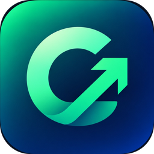
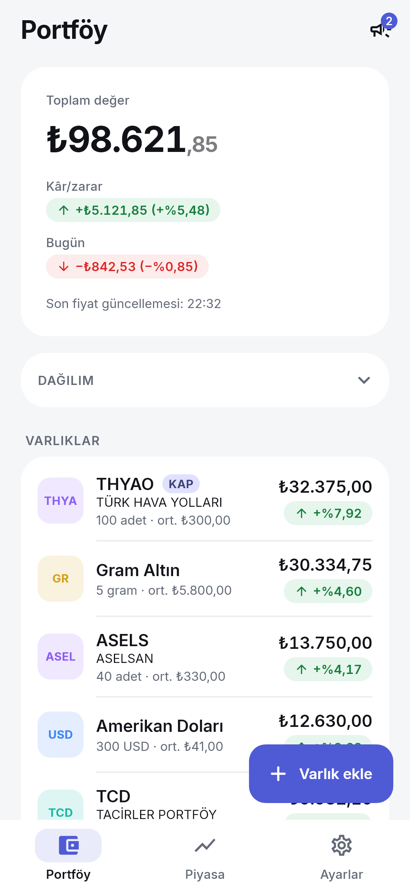
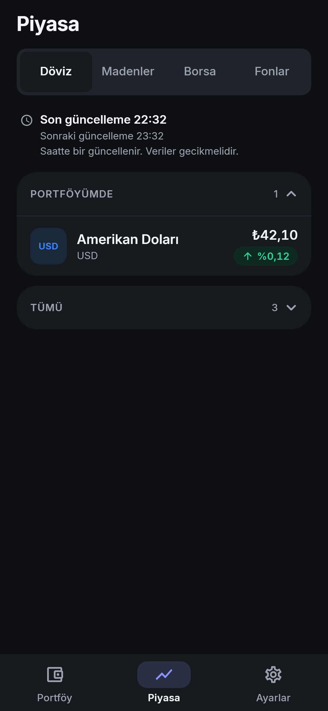
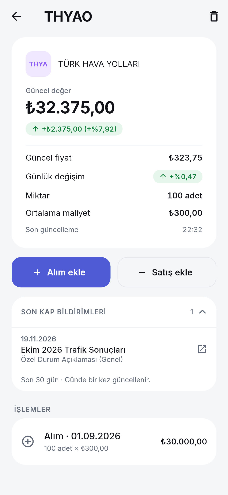

<div align="center">



# Capira

**Döviz, altın, hisse ve fonların tek ekranda.**<br>
Reklamsız, hesap açmadan, verilerin yalnızca telefonunda kalan kişisel portföy takibi.

[](https://github.com/oomerkaya/Capira/releases/latest)

[](LICENSE)

[**APK'yı indir**](https://github.com/oomerkaya/Capira/releases/latest) · [Özellikler](#özellikler) · [Kurulum](#kurulum) · [Kullanım](#kullanım) · [SSS](#sık-sorulan-sorular)

</div>

> [!IMPORTANT]
> **Capira resmi bir Bürküt uygulaması değildir.** Fiyatlar için [Bürküt Portföy](https://burkutportfoy.com) herkese açık API'sini kullanan, topluluk tarafından geliştirilen bağımsız bir istemcidir. Her kullanıcı kendi ücretsiz API anahtarını kullanır.

> [!WARNING]
> **Yatırım tavsiyesi değildir.** Gösterilen fiyatlar gecikmeli olabilir (BIST verileri en az 15 dakika gecikmelidir) ve yalnızca bilgi amaçlıdır. Bürküt lisanslı bir veri dağıtıcısı değildir. Uygulama hiçbir garanti verilmeden sunulur (bkz. [LICENSE](LICENSE)).

| Portföy | Piyasa | Hisse detayı |
|---|---|---|
|  |  |  |

## Neden Capira?

- **Her şey bir arada:** dolar, gram altın, çeyrek altın, BIST hisseleri ve TEFAS fonları aynı portföyde, tek toplamla.
- **Gerçek maliyet:** her alım ve satımı girersin; ortalama maliyet ve kâr/zarar otomatik hesaplanır.
- **Gizli:** hesap yok, sunucu yok, reklam ve izleme yok. Portföyün telefondan çıkmaz.
- **Ücretsiz ve açık kaynak:** kodun tamamı burada; istersen kendin derlersin.

## Özellikler

**Portföy**
- Alım/satım işlemleri, ağırlıklı ortalama maliyet, toplam değer, kâr/zarar ve günlük değişim.
- Tür ya da varlık bazında dağılım grafiği.
- Tutarları **₺, $ veya €** olarak gösterme. İşlem kendi gününde girildiyse kâr/zarar o günün kuruyla, gerçek dolar/euro bazında hesaplanır.
- **Gizlilik modu:** tek dokunuşla tüm tutarları gizle (yanında biri varken ya da ekran paylaşırken).

**Takip ve analiz**
- **Değer geçmişi:** portföyün değeri her gün kaydedilir; 1 hafta, 1 ay, 3 ay, 1 yıl ve tümü için grafik.
- **Haftalık ve aylık özet:** toplam değişim, bunun ne kadarının piyasadan ne kadarının alım/satımdan geldiği, en çok yükselen ve düşen varlıklar.
- **Birikim hedefleri:** "100 gram altın" ya da "25.000 $ portföy" gibi hedefler koy, ilerlemeyi gör.

**Piyasa**
- Döviz kurları; gram, çeyrek, yarım, tam, cumhuriyet ve ata altın; gram gümüş.
- BIST'teki tüm hisseler ve 2.400'den fazla TEFAS fonu.
- Türkçe karakter ve büyük/küçük harf duyarsız arama ("turk hava" → TÜRK HAVA YOLLARI).

**KAP bildirimleri**
- Portföydeki hisselerin son 30 günlük KAP bildirimleri, KAP'taki asıl metne bağlantıyla.
- Yeni bildirim sayısı rozeti; son 24 saatte bildirimi olan hissede "KAP" etiketi.
- Yorum ya da "olumlu/olumsuz" etiketi yoktur.

**Kullanım kolaylığı**
- **Günlük arka plan güncellemesi:** borsa kapanışından sonra, uygulama kapalıyken bile fiyatlar ve günün değeri güncellenir (Ayarlar'dan kapatılabilir).
- **Yedekleme:** portföyü tek dosyaya aktar, yeni telefonda geri yükle.
- Aydınlık / karanlık tema, büyük yazı boyutu ve ekran okuyucu desteği.

## Kurulum

Capira Google Play'de yok; APK dosyası buradan indirilir. Gereken: **Android 7.0 veya üstü**.

1. [Releases](https://github.com/oomerkaya/Capira/releases/latest) sayfasından en son `capira-<sürüm>.apk` dosyasını telefona indir.
2. Dosyayı aç. Android "bilinmeyen kaynaklardan yükleme" iznini sorarsa, dosyayı açtığın uygulamaya (tarayıcı ya da Dosyalar) izin ver.
3. **Yükle**'ye dokun. Play Koruma uyarı gösterirse "Yine de yükle"yi seç; uygulama mağazada olmadığı için bu uyarı normaldir.

**Güncelleme:** yeni sürümün APK'sını indirip aynı şekilde kur; verilerin silinmez. Yine de önemli bir güncellemeden önce **Ayarlar → Yedekleme**'den yedek almanı öneririz.

<details>
<summary><b>Kaynak koddan derlemek</b></summary>

1. [Flutter](https://docs.flutter.dev/get-started/install) **3.44.6** (stable) ve Android Studio kur.
2. Depoyu indir ve bağımlılıkları yükle:
   ```bash
   git clone https://github.com/oomerkaya/Capira.git
   cd Capira
   flutter pub get
   ```
3. Telefonu USB hata ayıklama açık bağla ve çalıştır:
   ```bash
   flutter run --release
   ```
   Ya da APK üret: `flutter build apk --release` → `build/app/outputs/flutter-apk/app-release.apk`

Kendi derlediğin APK farklı bir anahtarla imzalanır; Releases'taki sürümün üzerine kurulamaz. Önce yedek alıp eski uygulamayı kaldırman gerekir.

</details>

## Kullanım

### 1. API anahtarını gir

Fiyatlar için ücretsiz bir Bürküt API anahtarı gerekir:

1. [burkutportfoy.com/developers](https://burkutportfoy.com/developers) adresinden ücretsiz hesap aç ve bir API anahtarı oluştur (ayda 1.000 istek).
2. Capira'da **Ayarlar → Veri kaynağı → Bürküt API anahtarı**'na yapıştır. Anahtar kaydedilmeden önce doğrulanır.

Anahtar olmadan da portföyünü girebilirsin; yalnızca fiyat ve KAP bildirimi gelmez.

### 2. Varlıklarını ekle

**Portföy** ekranında **+** ile varlığı seç (ör. Gram altın, USD, THYAO, bir TEFAS fonu), ardından alım işlemini gir: tarih, miktar ve birim fiyat (TL). Sonraki alım ve satımları varlığın detay ekranından eklersin. Sayıları Türkçe yazabilirsin (`1.250,75`).

### 3. Takip et

- **Portföy:** toplam değer, kâr/zarar, dağılım, değer geçmişi, özet ve hedefler. Üstteki para birimi seçiciyle ₺/$/€, göz simgesiyle gizlilik modu.
- **Varlık detayı:** portföydeki bir varlığa dokununca işlemleri, maliyeti ve (hisselerde) KAP bildirimleri açılır. Sağ üstteki KAP simgesi tüm bildirimleri gösterir.
- **Piyasa:** döviz, maden, borsa ve fon fiyatları; arama.
- **Ayarlar:** tema, API anahtarı ve bu ayki istek kullanımı, arka plan güncellemesi, yedekleme.

## Veri ve güncelleme

Capira, ücretsiz kotayı (ayda 1.000 istek) korumak için uygulama açıkken aşağıdaki aralıklarla istek gönderir; ekranı aşağı çekmek bu aralıkları kısaltmaz. Ayrıca günde bir kez, borsa kapanışından sonra arka planda güncellenir.

| Veri | Ne zaman | İstek |
|---|---|---|
| Döviz, altın/gümüş | Her gün, saatte bir | Kategori başına 1 |
| BIST hisseleri | Hafta içi 10:00-18:00, saatte bir (tatilde yok) | Tüm piyasa için 1 |
| TEFAS fonları | Hafta içi, günde bir | 1 |
| KAP bildirimleri | Günde bir, 08:00'den sonra | 1 |
| Arka plan (kapanış sonrası) | Günde bir, 18:20'den sonra; uygulama zaten güncellediyse istek yok | En fazla 5 |
| Kota durumu | Ayarlar açılınca | Kota harcamaz |

Normal kullanımda ayda yaklaşık 250-700 istek harcanır. İnternet yoksa ya da kota dolduysa son bilinen fiyatlar gösterilir.

## Gizlilik ve güvenlik

- **Sunucu yok:** portföyün, işlemlerin ve değer geçmişin yalnızca telefondaki yerel veritabanında durur. Capira'nın kendine ait bir sunucusu, analitiği ya da reklamı yoktur.
- **Ağ trafiği** yalnızca fiyat ve KAP verisi için Bürküt API'sine, şifreli (HTTPS) bağlantıyla gider. Portföy bilgisi hiçbir yere gönderilmez.
- **API anahtarı** Android Keystore ile şifrelenmiş depoda tutulur; yedek dosyasına girmez.
- **Bulut yedeği kapalı:** uygulama verisi Google yedeğine ya da cihaz aktarımına dahil edilmez. Yedek yalnızca senin oluşturduğun dosyadır.
- **İzinler:** yalnızca internet, ağ durumu, telefon yeniden başlayınca günlük güncellemeyi kurma ve arka planda kısa süre uyanık kalma. Bildirim, konum, rehber ya da dosya izni istemez.

## Sık sorulan sorular

<details>
<summary><b>Fiyatlar neden gelmiyor?</b></summary>

Ayarlar'da API anahtarının kayıtlı olduğunu ve bu ayın kotasının dolmadığını kontrol et. Hisseler yalnızca seans saatlerinde güncellenir; borsa kapalıyken son kapanış fiyatı görünür.
</details>

<details>
<summary><b>Değer geçmişi neden boş?</b></summary>

Grafik her gün kaydedilen değerlerle oluşur; ilk günlerde nokta sayısı azdır. Arka plan güncellemesi açıksa uygulamayı açmadığın günler de kaydedilir.
</details>

<details>
<summary><b>Arka plan güncellemesi bazı günler çalışmıyor.</b></summary>

Xiaomi, Huawei, Oppo gibi bazı üreticiler pil tasarrufu için arka plan işlerini durdurabilir. Telefonun pil ayarlarında Capira için kısıtlamayı kaldırmak çözer.
</details>

<details>
<summary><b>Telefon değiştireceğim, verilerim ne olacak?</b></summary>

Eski telefonda **Ayarlar → Yedekleme → Portföyü dışa aktar** ile dosyayı kaydet, yeni telefonda **Yedekten geri yükle** ile aç. API anahtarını yeni telefonda tekrar girmen gerekir.
</details>

<details>
<summary><b>iOS sürümü olacak mı?</b></summary>

Şimdilik yalnızca Android var.
</details>

## Teknik

- Flutter (Android), feature-first katmanlı mimari (data / domain / presentation).
- Riverpod, Drift (SQLite), go_router, dio, WorkManager. Para ve miktar hesapları `Decimal` ile yapılır.
- API anahtarı yalnızca cihazın şifreli deposunda tutulur; kodda, loglarda ya da yedek dosyasında yer almaz.

## Lisans

[MIT](LICENSE). Uygulamanın kullandığı açık kaynak paketlerin ve Inter yazı tipinin lisansları uygulamada **Ayarlar → Açık kaynak lisansları** altındadır.
